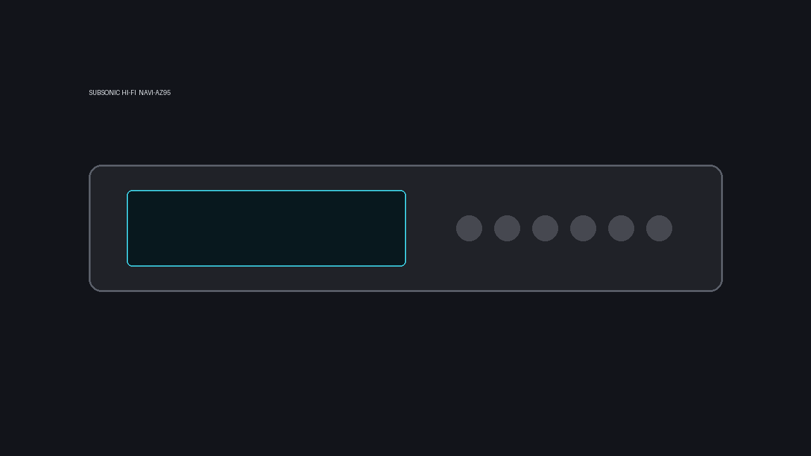
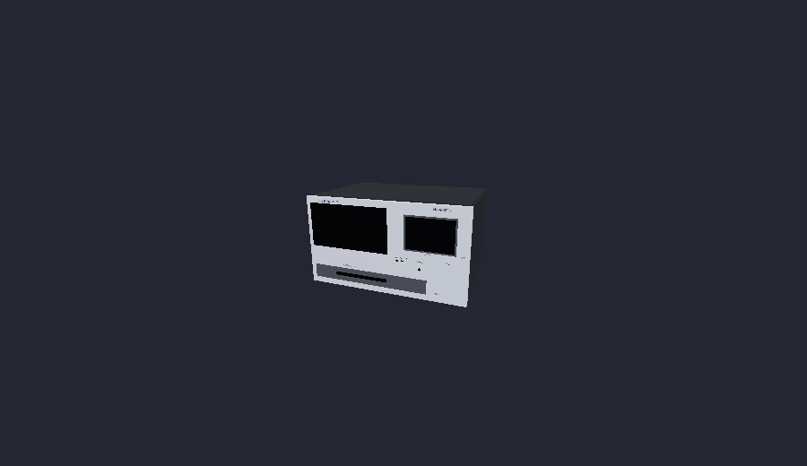

# Subsonic Hi-Fi NAVI-AZ95 (`xenu.subsonic`)

A hi-fi CD changer for the [RetroXR](https://github.com/RetroXR/RetroXR) room that plays your own music server and
internet radio.

- **Music server**: anything that speaks the [Subsonic API](https://www.subsonic.org/pages/api.jsp), tested with
  [Navidrome](https://www.navidrome.org). Browse artists, albums and tracks on the unit's screen, search, play.
- **Internet radio**: Icecast and Shoutcast style streams and playlists, tested with
  [AzuraCast](https://www.azuracast.com), whose now-playing information the unit reads. Add your own stations from the
  TAB menu; the stations your server keeps (Navidrome: Radios) are listed with them.
- **Local cache**: a size-capped cache of the tracks you play (default 50 MB, set from the TAB menu).

## Screenshots

## Install

Get `xenu.subsonic-<version>.zip` from the [releases](../../releases) and put it in your RetroXR data folder, under
`mods/` (`~/retroxr/mods/` on desktop). Then enable it in the MODS tab.

## Build the pack

    python3 tools/pack_mod.py            # writes dist/xenu.subsonic-<version>.zip and reads it back
    python3 tools/pack.py                # builds the pack and deploys it to ~/retroxr/mods/ (local testing)

The pack holds source files only. `res/` (the thumbnail and the screenshots) stays out of it, except the thumbnail,
which is packed as `thumbnail.png`.

## Tests

    python3 -I tests/publish_modio_test.py
    python3 -I tests/release_version_test.py
    python3 tests/run_all.py             # Godot through flatpak-spawn --host

## Releases

A push to `main` publishes a release when it brings a `feat`, `fix` or `perf` commit since the previous one. The version
is computed from the commits, not written by hand: `feat` raises the minor, `fix`/`perf` the patch, a breaking change
(`!` or a `BREAKING CHANGE:` footer) the major (the minor while it is 0). `chore`, `docs`, `ci` and the like release
nothing. The notes are the commits since the previous release: `feat` under Changes, `fix` under Fixes. The same zip,
version and notes are then added to the mod on [mod.io](https://mod.io/g/retroxr/) by
[`tools/publish_modio.py`](tools/publish_modio.py), using the secret `MODIO_PAT` and the optional variable
`MODIO_MOD_SLUG`. Its visibility is never changed.

## Not affiliated

"Subsonic Hi-Fi NAVI-AZ95" is the in-game make. Subsonic, Navidrome and AzuraCast are the names of the protocol and of
the projects this mod talks to; the mod is not affiliated with or endorsed by any of them.
